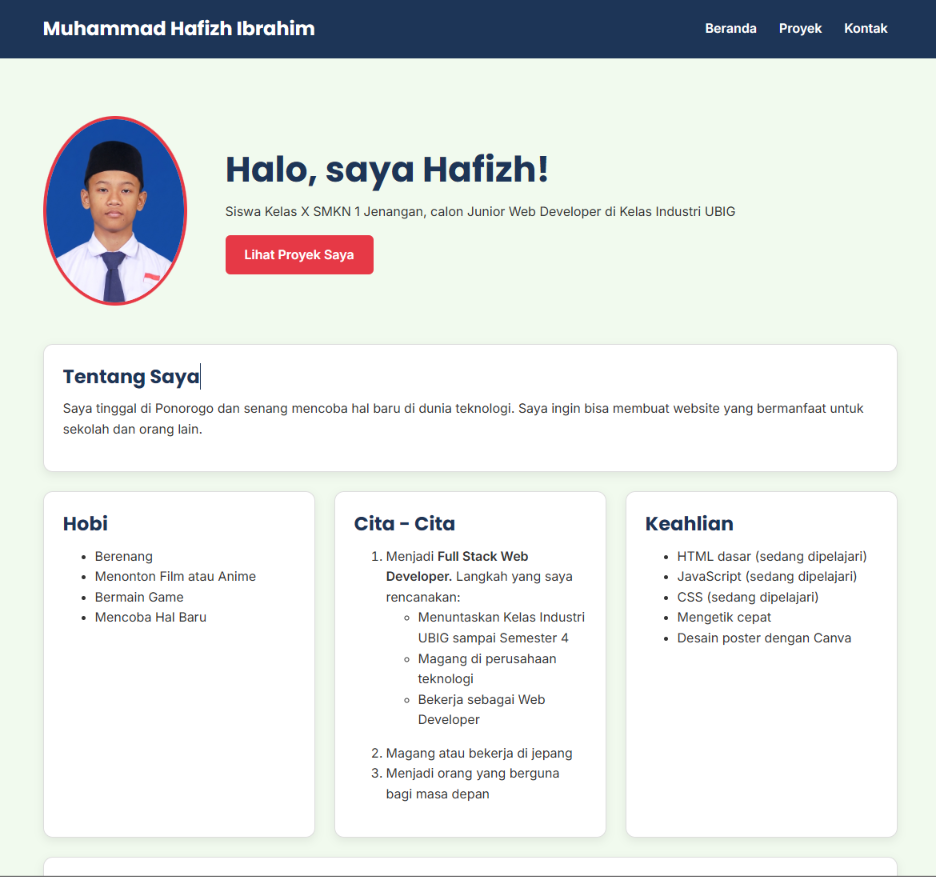

# Portofolio Muhammad Hafizh Ibrahim

Website portofolio pribadi ini saya kembangkan dari nol selama mengikuti program Kelas Industri UBIG (Paket 1, Minggu 01 - 05). Desainnya sudah dibuat responsif agar tata letaknya tetap rapi saat dibuka lewat HP, tablet, maupun laptop.

## Tampilan

## Fitur

- Halaman **Beranda**: Berisi profil singkat, hobi, target saya untuk menjadi Full Stack Web Developer, serta jadwal belajar mandiri.
- Halaman **Proyek**: Menampilkan daftar karya dan tugas praktik yang dibungkus dalam tata letak kartu (*card*).
- Halaman **Kontak**: Formulir simpel untuk pengunjung yang ingin menghubungi atau bekerja sama.
- Tampilan responsif (menyesuaikan ukuran layar) menggunakan pendekatan *Mobile-First*.

## Teknologi

- HTML5
- CSS3 (Flexbox & Media Query)
- Git & GitHub (Version Control)
- Vercel (Deployment)
- VS Code & Live Server

## Tautan

- Website: https://portofolio-hafizhibrahim.vercel.app/
- Dibuat oleh: Muhammad Hafizh Ibrahim, Siswa X RPL B SMKN 1 Jenangan